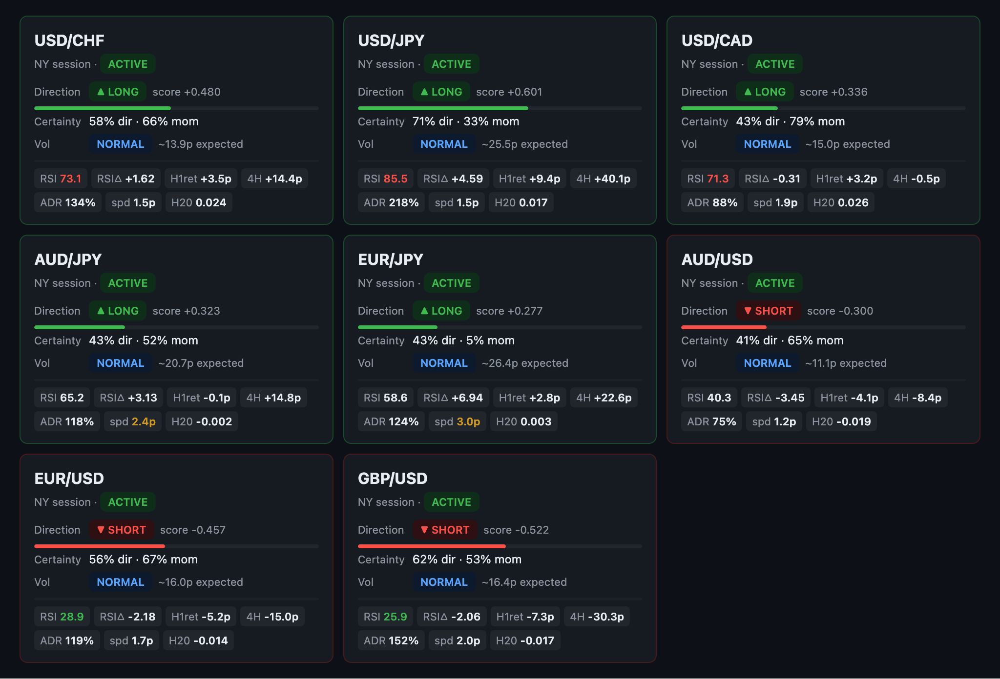

# Mr. Scrooge V5

Automated forex trading bot for OANDA. Modular ML pipeline: direction signal → momentum filter → playmaker decision → step-trail ratchet exit (with optional TP1/TP2 partial-close ladder). Live on 8 currency pairs.

Engine loop runs at two cadences:
- **300s scan**: build MarketViews, stamp signals, playmaker picks an entry.
- **30s manage**: cheap pricing poll to detect server-stop exits and tick the ratchet between scans — keeps the trailing stop close to the peak.

---

## Expected Performance

Full analysis in [docs/EDGE_REPORT.md](docs/EDGE_REPORT.md).

| Metric | Value |
|--------|-------|
| Direction accuracy (module level) | 70-73% London / 70-72% Asia / 69-73% NY |
| Estimated trade win rate | 65-70% |
| E[pip/trade] gross of spread | +3.3-4.9p |
| E[pip/trade] net of spread | +2.5-4.0p |
| Initial stop-loss | **−12p** from entry (live-editable; 8yr sweep-validated) |
| Edge classification | **HIGH** |
| Research basis | 8-year OOS walk-forward, all 8 pairs |
| Live confirmation | In progress — V5 launched 2026-06-18 |

**The ratchet is essential.** Without trail-and-lock exit management, the same signal produces +0.75p/trade (LOW edge). The ratchet converts trades that run 20+ pips MFE into locked profits.

**Manage faster than you scan.** The 300s scan loop sets the entry pace; the 30s management poll lets the stop track the peak between scans. MFE analysis showed runners giving back ~10.5p before the split — the 30s poll closes most of that gap.

**London is strongest.** EUR/JPY, USD/JPY, and GBP/USD London are the widest cells (28-30p D1-D10 span). Asia and NY are real but smaller.

These are backtested numbers. Allow 50-100 live trades before drawing conclusions about live vs backtest alignment.

---

## Architecture

```
 ┌──────────────────────────────────────────────────────────────────────────┐
 │  main.py → Engine.run_forever(scan=300s, manage=30s)                     │
 │  ──────────────────────────────────────────────────────────────────────  │
 │  every 30s:  _manage()  → exit-detect + ratchet (cheap pricing poll)     │
 │  every 300s: _cycle()    → _manage() + scan + signal stamp + playmaker   │
 └──────────────────────────────────────────────────────────────────────────┘
         │                          │
         ▼                          ▼
 ┌──────────────┐          ┌────────────────┐
 │  OandaFeed   │          │  OandaBroker   │
 │              │          │                │
 │ • M5/H1/D    │          │ • place_market │
 │ • pricing()  │◄─── 30s ─┤ • open_positions│
 │   cheap poll │   poll   │ • close_position(units=...) │
 │ • get_views()│  on 30s  │ • move_stop    │
 │   full M5/H1 │  → 300s  │ • account_summary │
 │   build      │  full    │ • size_units(sl_pips, risk_pct) │
 └──────┬───────┘          └────────────────┘
        │
        │  list[MarketView]
        ▼
 ┌────────────────────────────────┐
 │  Signal Modules                │
 │  (modules/signals/)            │
 │                                │
 │  DirectionModule × 24          │
 │  ┌──────────────────────────┐  │
 │  │ dm_04 calibration        │  │
 │  │ (24 features × 8 pairs   │  │
 │  │  × 3 sessions ny/lon/asia)│  │
 │  │ → DirectionStamp         │  │
 │  │   bias: long/short/block │  │
 │  │   score:  −1.0 .. +1.0   │  │
 │  │   certainty: 0..1        │  │
 │  └──────────────────────────┘  │
 │                                │
 │  MomentumModule × 24           │
 │  ┌──────────────────────────┐  │
 │  │ vol_regime: low/norm/    │  │
 │  │   high/extreme           │  │
 │  │ expected_pips: pips/hr   │  │
 │  │ certainty: 0..1          │  │
 │  └──────────────────────────┘  │
 └────────────────┬───────────────┘
                  │  list[PairTicket]
                  ▼
 ┌────────────────────────────────┐
 │  Playmaker  (modules/playmaker)│
 │                                │
 │  pick_best(tickets, now,       │
 │            sl_history):        │
 │  • config-driven (per-pair):   │
 │      enabled, dir.score floor, │
 │      dir.cert floor,           │
 │      mom.cert floor,           │
 │      cooldown_after_sl_min     │
 │  • account-level:              │
 │      max_concurrent_trades,    │
 │      margin_pct_per_trade      │
 │  • session gate (asia/lon/ny)  │
 │  • spread gate (per pair)      │
 │  • ranked by composite_score   │
 │    = |dir.score| × dir.cert    │
 │      × mom.cert                │
 │                                │
 │  → TradeTicket or None         │
 └────────────────┬───────────────┘
                  │  Engine._open_trade()
                  │  → broker.size_units(sl_pips, risk_pct)
                  │  → SL at −initial_sl_pips server-side
                  ▼
 ┌────────────────────────────────┐
 │  RatchetManager                │
 │  (modules/management/ratchet)  │
 │                                │
 │  Step-trail exit               │
 │  Config: exit_config.json      │
 │  Per-pair overrides supported  │
 │                                │
 │  Optional TP1/TP2 ladder       │
 │  (defaults OFF — ratchet-only) │
 │    TP1: peak ≥ tp1_at →        │
 │      close tp1_close_pct of    │
 │      initial position,         │
 │      optionally lock SL        │
 │    TP2: after TP1, peak ≥      │
 │      tp2_at → close tp2_pct    │
 │      Ratchet trails remainder. │
 │                                │
 │  update() each 30s tick:       │
 │  1. peak tracking              │
 │  2. _check_tp_ladder()         │
 │  3. cadence-gated trail lock   │
 │  4. broker.move_stop() if SL   │
 │     advances                   │
 │  5. local-detect exit if price │
 │     crosses locked SL          │
 │     (server-side is primary)   │
 └────────────────────────────────┘

 Dashboard  ──  ops/panel.html  served on :8084
 ┌─────────────────────────────────────────────────────────────────┐
 │ LIVE │ PAIRS │ HEALTH │ SYSTEM │ TUNE │ PLAYMAKER                │
 │ acct │ sig   │ engine │ cpu    │ SL   │ account knobs (risk,    │
 │ pos+ │ cards │ health │ ram    │ rat  │   max concurrent)       │
 │ events│ per  │ per    │ svcs   │ TP   │ per-pair gates +        │
 │      │ pair  │ pair   │ jrnl   │      │   cooldown              │
 └─────────────────────────────────────────────────────────────────┘
```

---

## Dashboard

Served on port `8084`. Six tabs: **LIVE / PAIRS / HEALTH / SYSTEM / TUNE / PLAYMAKER**.



*PAIRS tab — one card per pair. Each card shows the active session, direction bias (LONG/SHORT/block) with the signed `direction.score`, direction and momentum certainty bars (the playmaker gates each independently), volatility regime + expected pips for the next hour, and a row of raw indicator chips: `RSI` / `RSIΔ` / `H1ret` / `4H` / `ADR%` (range consumed today) / `spd` (spread in pips) / `H20` (20-day signed return). Green border = direction.bias is actionable; red = blocked. Click TUNE or PLAYMAKER to live-edit the gates these cards are scored against.*

---

## Directory Layout

```
mr-scrooge-v5/
├── main.py                       # Entry: --live for live trading
├── config/
│   ├── pairs.py                  # 8-pair PAIRS list + PIP sizes + PAIR_SESSIONS
│   ├── sessions.py               # Canonical coarse_session() (asia/london/ny) — single source of truth
│   ├── exit_config.json          # Live-editable SL + ratchet + TP1/TP2 (defaults + per_pair)
│   └── playmaker_config.json     # Live-editable account (risk_pct, max_concurrent) + per-pair gates
├── core/
│   ├── engine.py                 # run_forever(scan=300, manage=30); _cycle + _manage; SL-history dict
│   ├── feed/oanda.py             # OandaFeed: pricing() cheap poll + get_views() full build
│   └── broker/oanda.py           # OandaBroker: order + account; close_position(units=...) supports partial
├── modules/
│   ├── signals/                  # DirectionModule + MomentumModule (24 instances each)
│   ├── playmaker/playmaker.py    # pick_best() — reads playmaker_config.json per pair
│   └── management/
│       ├── base.py               # Position, ExitSignal, TradeManager
│       └── ratchet.py            # RatchetManager: step-trail + TP1/TP2 ladder
├── ops/
│   ├── panel.html                # Dashboard (6 tabs)
│   └── server.py                 # HTTP server thread on :8084 (GET + POST /api/config/{exit,playmaker})
├── docs/
│   └── research/                 # ML research artifacts (dm05-dm09, factor_sweep)
└── tests/
```

---

## Pairs

```
EUR_USD  GBP_USD  AUD_USD  USD_JPY
USD_CAD  USD_CHF  AUD_JPY  EUR_JPY
```

All 8 pairs run the same management + entry + exit stack. PIP sizes: non-JPY = 0.0001, JPY pairs = 0.01.

Per-pair session map (`config/pairs.py`):

| Pair | Trades in |
|---|---|
| AUD_JPY | asia, london |
| AUD_USD | asia, london, ny |
| EUR_JPY | london, ny |
| EUR_USD | london, ny |
| GBP_USD | london, ny |
| USD_CAD | ny |
| USD_CHF | london, ny |
| USD_JPY | asia, london, ny |

Coarse session windows (UTC, in `config/sessions.py`, single source of truth):
- `asia`   = 22:00–07:00
- `london` = 07:00–13:00
- `ny`     = 13:00–22:00

---

## Exit config (`config/exit_config.json`)

Live-editable via the **TUNE** tab on the dashboard. Schema is `{defaults, per_pair}` — per-pair entries override individual fields for that pair only; the ratchet re-reads on every 30s tick.

**Defaults (as of 2026-06-18, post-Phase-1+2 + early-lock tune):**

| Key | Default | Meaning |
|---|---|---|
| `initial_sl_pips` | 12.0 | Server-side SL placed at fill (was code const; 8yr-validated) |
| `step_engage_min` | 0.0 | Minutes before first ratchet check (0 = immediate) |
| `step_cadence_min` | 0.5 | Minutes between SL evaluation cycles (re-locks ~each 30s poll) |
| `step_trigger_pips` | 4.5 | Peak MFE required before first SL movement |
| `step_size_pips` | 5.0 | Distance between ratchet rungs |
| `step_trail_pips` | 1.5 | SL parks this many pips below the rung level |
| `tp1_enabled` | **false** | Partial-close ladder — ported from V4 harvest_ladder; off by default |
| `tp1_at_pips` | 12.0 | Peak MFE that triggers TP1 partial close |
| `tp1_close_pct` | 0.50 | Fraction of INITIAL position closed at TP1 |
| `tp1_lock_pips` | 6.0 | SL bump when TP1 fires (pips above entry); 0 = no bump |
| `tp2_enabled` | **false** | TP2 requires TP1 enabled |
| `tp2_at_pips` | 20.0 | Peak MFE that triggers TP2 |
| `tp2_close_pct` | 0.25 | Fraction of INITIAL position closed at TP2 |

**Lock ladder** (with defaults): peak +4.5p → SL +3.0p; peak +9.5p → +8.0p; peak +14.5p → +13.0p; …

**Cross-rules** enforced server-side:
- `step_trail_pips < step_trigger_pips` (else first lock ≤ 0)
- `tp2_enabled` requires `tp1_enabled`
- `tp1_close_pct + tp2_close_pct < 1.0` (runner must remain)
- `tp2_at_pips > tp1_at_pips`

---

## Playmaker config (`config/playmaker_config.json`)

Live-editable via the **PLAYMAKER** tab on the dashboard. Two layers — **account-level** (risk, max concurrent) and **per-pair gates** (enabled, score floors, cooldown). Per-pair overrides only listed fields; blanks inherit the default.

**Account knobs (defaults as of 2026-06-18):**

| Key | Default | Notes |
|---|---|---|
| `margin_pct_per_trade` | **0.20** | **Margin-based sizing (V1 model)**: fraction of BALANCE used as MARGIN per trade. `units = (balance × margin_pct) / (base_price_usd × per-instrument margin_rate)`. SL distance no longer affects position size. With 4 concurrent → 80% max simultaneous margin used. |
| `max_concurrent_trades` | 4 | Cap on open positions. |

Per-instrument margin rates are fetched from OANDA `/instruments` and cached on the broker. The base→USD conversion handles USD-base pairs (1.0), USD-quote pairs (the pair's mid), and crosses like AUD_JPY (uses AUD_USD mid).

**Per-pair gates (defaults):**

| Key | Default | Meaning |
|---|---|---|
| `enabled` | true | Set false to block new entries on this pair |
| `min_direction_score` | 0.25 | Minimum `\|direction.score\|` to pass |
| `min_dir_certainty` | 0.30 | Minimum `direction.certainty` |
| `min_mom_certainty` | 0.25 | Minimum `momentum.certainty` |
| `cooldown_after_sl_min` | 0 | Minutes the playmaker blocks this pair after a losing exit on it. **In-memory** — clears on restart. |

Spread gate (per-pair, in `playmaker.py`): candidate dropped if spread exceeds the pair's max — EUR_USD/AUD_USD 2.5p, USD_JPY 2.0p, GBP_USD/USD_CAD/USD_CHF 3.0p, EUR_JPY 3.5p, AUD_JPY 4.0p.

---

## Feed Features (MarketView)

22+ fields computed from OANDA M5/H1/D candles each 300s cycle (`core/feed/oanda.py:_compute_features`). The full management loop calls the cheap `pricing()` endpoint on the 30s tick — no candle re-fetch.

| Field | Source | Used by |
|---|---|---|
| `h1_ret_1bar`, `h1_ret_4bar` | H1 returns | Direction: trend |
| `rsi14`, `rsi_slope` | H1 RSI-14 + delta | Direction |
| `zscore_1h`, `ema20_1h_dist` | H1 vs SMA20 / EMA20 | Direction |
| `htf_pct_20`, `htf_pct_60` | Signed D-bar returns | Direction: HTF alignment |
| `pdh_dist`, `pdl_dist` | Prev-day high/low proximity | Direction |
| `adr_consumed`, `d_ret` | Daily range + running return | Momentum + direction |
| `spread_pips` | Live bid/ask | Playmaker gate |
| `atr14_h1` | H1 Wilder ATR-14 | Momentum: vol regime |

---

## Dashboard tabs (port 8084)

- **LIVE** — account bar (NAV, balance, open P/L, All-Time P/L, margin used, open trades), open positions table (entry / age / SL locked / peak MFE / net now / uP&L), recent events feed
- **PAIRS** — per-pair signal cards (direction bias + score + cert, momentum vol + cert, spread)
- **HEALTH** — engine status, last-cycle market data
- **SYSTEM** — CPU/RAM/disk, services list, last 40 journal lines
- **TUNE** — live-edit `exit_config.json`: SL, ratchet trail params, TP1/TP2 ladder. Defaults + per-pair overrides. Cross-rule validation server-side.
- **PLAYMAKER** — live-edit `playmaker_config.json`: account (risk_pct, max concurrent) + per-pair gates (enabled, score floors, cooldown). Risk math is shown live (`risk × max_concurrent = max simultaneous`).

---

## Credentials

All in `~/.openclaw/secrets.env` on EC2 (chmod 600). Never stored in code.

```
OANDA_API_URL=
OANDA_API_TOKEN=
OANDA_ACCOUNT_ID=
GITHUB_TOKEN_SCROOGE_V5=
```

---

## Operations

```bash
# Live trading (EC2)
systemctl --user start mr-scrooge-v5
systemctl --user restart mr-scrooge-v5

# Dry run (signals only, no orders)
python main.py

# Live run directly
python main.py --live

# Dashboard
open https://[REDACTED-HOST]:8084/

# Tail logs
journalctl --user -u mr-scrooge-v5 -f -o cat

# Edit configs live (no restart):
#   - via dashboard:  TUNE tab + PLAYMAKER tab
#   - via file:       nano config/exit_config.json
#                     nano config/playmaker_config.json
# Initial SL is a config field (initial_sl_pips), no longer a code const.
# Ratchet re-reads on each 30s tick; new entries read at placement time.

# Run tests
python -m pytest tests/ -v
```

---

## Git Remotes

```
origin → github.com/BrockStar3540/mr-scrooge-v5     (GITHUB_TOKEN_SCROOGE_V5 embedded)
alien  → brock-mini-mac@[REDACTED-IP]:git-mirrors/mr-scrooge-v5.git
```

Deploy: push EC2 → origin, then `git push alien main`. Both are kept in sync after every commit.

---

## Version History

| Date | Commit | Change |
|---|---|---|
| 2026-06-18 | `40b1832`  | **Margin-based sizing** (V1 model): rename `risk_pct_per_trade`→`margin_pct_per_trade`; broker.size_units now `units = (balance × margin_pct) / (base_price_usd × margin_rate)`. SL no longer affects size. Old config key auto-migrates on load. |
| 2026-06-18 | `d5c4f94` | **PLAYMAKER tab** — per-pair enable/floors/cooldown + account-level risk_pct (default 0.20) + max_concurrent (default 4). Was code constants. |
| 2026-06-18 | `b31caac` | **TP1/TP2 partial-close ladder** ported from V4 harvest_ladder. Defaults OFF; ratchet-only behavior preserved when disabled. |
| 2026-06-18 | `e55d403` | **TUNE tab** — live-edit `exit_config.json` for SL + ratchet (defaults + per-pair). Schema migrated to `{defaults, per_pair}`. Initial SL moved from code const to config. |
| 2026-06-18 | `8d083d9` | Early-lock tune: ratchet `step_trigger` 7→4.5, `step_trail` 3→1.5 (first lock now +3p at peak +4.5p). |
| 2026-06-18 | `72e33fc` | **Phase 2**: split engine loop into 30s `_manage()` (exit-detect + ratchet) and 300s `_cycle()` (full scan + entry). Initial SL 15→12 (8yr-validated). |
| 2026-06-18 | `ee65ffa` | **Phase 1** ratchet retune: `cadence` 20→5, `trail` 6→3, `trigger` 10→7. |
| 2026-06-18 | `843a460` | Dashboard relabel: "Today P/L" → "All-Time P/L" (it always was lifetime realized). |
| 2026-06-18 | `e26dba7` | **Session-label fix**: `pick_best` was computing fine-grained labels (`ny_mid`/`ny_open`/…) that never matched `PAIR_SESSIONS` — silently disabled all NY-session trading + half of every other session. Single source of truth now `config.sessions.coarse_session`; playmaker gates on each ticket's feed-stamped session. |
| 2026-06-18 | V5 init | Modular ML pipeline, step-trail ratchet, 8 pairs. V4 retired same day; full archive on Dropbox `V4-Archive-2026-06-18/`. |
